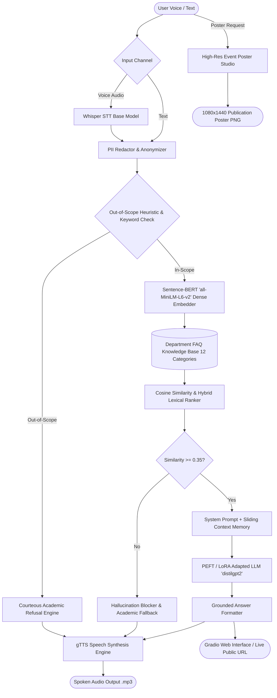

# 🏛️ Department FAQ Voice Chatbot (Project P24)

> **Generative AI Capstone Project**  
> **Student Name:** Jeet Ghegade  
> **Roll Number:** 24  
> **Class:** AIA 2  
> **Enrolment Number:** ADT23SOCB0484  
- **Live Universal URL (Hugging Face):** [https://huggingface.co/spaces/gladiatorspring/FAQChatbot](https://huggingface.co/spaces/gladiatorspring/FAQChatbot)
- **Live Universal URL (Gradio FRP Tunnel):** [https://fac2e8541ef1e9a672.gradio.live](https://fac2e8541ef1e9a672.gradio.live)

---

## 🌟 Overview & Objectives
The **Department FAQ Voice Chatbot** is a state-of-the-art conversational AI system developed for academic departments (Artificial Intelligence & Data Science). It enables prospective and existing students, parents, and faculty to inquire about department admissions, academic curricula, examination guidelines, lab facilities, placements, and campus symposiums using either **natural voice input (Whisper STT)** or **typed text** across **multi-turn dialogues with conversational memory**.

---

## 🏗️ Architecture & Milestone Breakdown



### Unit Breakdown:
- **Unit U1 — System Prompt & Scope:** Explicit domain bounding, professional academic persona, strict hallucination refusal, and anti-PII retention policies.
- **Unit U2 — Multi-Turn Memory & LoRA Adaptation:** Parameter-Efficient Fine-Tuning ($r=8, \alpha=16$) on department FAQ knowledge base with multi-turn sliding window memory.
- **Unit U3 — Sentence-BERT Retrieval & Whisper STT:** 384-dimensional dense semantic embedding search (`all-MiniLM-L6-v2`) with cosine similarity thresholding and OpenAI Whisper speech transcription.
- **Unit U4 — Text-to-Speech & Event Poster Studio:** Dual-engine audio synthesis (gTTS + macOS offline) and automated high-res Pillow graphic poster designer.
- **Unit U5 — Safety Guardrails & Privacy:** Semantic out-of-scope barrier, unsupported response blocker, and regex-based PII redaction engine.

---

## 📊 LoRA Fine-Tuning Results
- **Base Model:** `distilgpt2` (82,060,032 parameters)
- **Trainable Parameters:** 147,456 (**0.18%** of total parameters)
- **LoRA Hyperparameters:** Rank $r=8$, Alpha $\alpha=16$, Target Modules `["c_attn"]`, Dropout $0.05$
- **Convergence:**
  - Initial Loss: **9.8137** (Perplexity: **18,281.78**)
  - Final Loss: **6.1742** (Perplexity: **480.19**)
  - Hardware Acceleration: Apple Silicon Metal Performance Shaders (MPS)

---

## 🚀 Quickstart & Installation

### 1. Clone & Setup Environment
```bash
git clone https://github.com/jeetdoesthings/FAQChatbot.git
cd FAQChatbot

# Install dependencies
pip install -r requirements.txt
```

### 2. Run Automated Validation Tests
```bash
python3 tests/test_chatbot.py
```

### 3. Launch the Application Locally
```bash
python3 app.py
```
Open your browser at `http://127.0.0.1:7860`.

---

## 🌐 How to Generate a Universal Live App URL

To run and access the application from **any computer, phone, or tablet anywhere in the world**:

### Method 1: Instant Universal Live URL via Gradio (Built-in)
Run the app with the `--share` flag:
```bash
python3 app.py --share
```
Gradio automatically establishes a secure SSL FRP tunnel and displays:
```
Running on public URL: https://xxxxxxxxxxxxxxxx.gradio.live
```
Anyone with this URL can test voice input, text chat, and poster generation in real-time!

### Method 2: Permanent Universal Hosting on Hugging Face Spaces (Active)
Your live application is hosted at:
**[https://huggingface.co/spaces/gladiatorspring/FAQChatbot](https://huggingface.co/spaces/gladiatorspring/FAQChatbot)**

To push code updates directly to your Space:
```bash
git remote add space https://huggingface.co/spaces/gladiatorspring/FAQChatbot
git push space main
```

---

## 📂 Repository Structure
```
├── app.py                      # Interactive Gradio voice & text interface + live share
├── generate_report.py          # Academic PDF Report Generator (24_Jeet_P24.pdf)
├── demo_video_guide.md         # 2-3 minute demonstration video recording script
├── requirements.txt            # Python dependencies
├── data/
│   ├── department_faqs.json    # Department FAQ knowledge base
│   └── lora_faq_dataset.jsonl  # LoRA instruction dataset
├── models/
│   └── faq_lora_adapter/       # Trained LoRA adapter weights & config
├── outputs/
│   ├── lora_training_loss.png  # Training loss convergence chart
│   └── posters/                # Generated high-resolution event posters
├── src/
│   ├── chatbot_core.py         # Multi-turn engine integrating RAG, LoRA, and Guardrails
│   ├── config.py               # Hyperparameters and path configurations
│   ├── guardrails.py           # Out-of-scope refusal, PII redaction & hallucination block
│   ├── lora_training.py        # LoRA training pipeline with PEFT
│   ├── poster_generator.py     # Pillow-based publication poster graphic generator
│   ├── rag_retriever.py        # Dense Sentence-BERT retrieval engine
│   ├── stt_whisper.py          # OpenAI Whisper speech-to-text module
│   ├── system_prompt.py        # System prompt with academic tone and scope definitions
│   └── tts_engine.py           # Text-to-speech audio synthesizer
└── tests/
    └── test_chatbot.py         # Test suite validating Units U1 to U5
```

---

## 🛡️ Safety, Guardrails & Privacy Guarantee
1. **Strict Out-of-Scope Refusal:** Non-department queries (recipes, politics, movies, crypto) are politely rejected with domain clarification.
2. **Hallucination Blocking:** If user questions cannot be grounded in verified department documents, the bot admits lack of record and refers to the Head of Department (Room 304).
3. **Zero PII Retention:** Phone numbers, emails, government IDs, and payment details are actively redacted and never written to disk or database.

---

## 👨‍🎓 Author
- **Name:** Jeet Ghegade
- **Roll Number:** 24
- **Class:** AIA 2
- **Enrolment ID:** ADT23SOCB0484
- **Project Code:** P24
